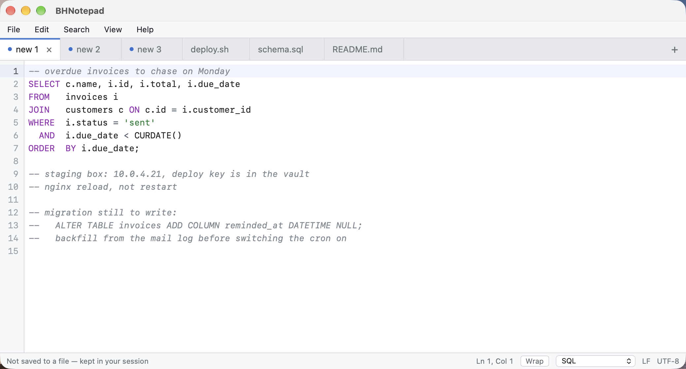

# BHNotepad — a notepad whose unsaved tabs survive quitting

Close it with ten unsaved scratch notes open. It will not ask you to save or discard.
Open it again and every tab is exactly where you left it.

That is the whole point. Every other editor treats an unsaved buffer as a problem to resolve
before you are allowed to quit. Notepad++ on Windows does not, and that is the one habit that
has no equivalent on macOS or Linux — so this is it.

**Free, open source (MIT), no telemetry, no account.** A 2–3 MB download, under 5 MB installed.
The only thing it ever sends is an update check to GitHub, and you can turn that off.
macOS · Windows · Linux.

---



*Three scratch notes and three real files, side by side. The dots mean those tabs live in your
session rather than in a file — which is the normal resting state here, not a warning. Quit now
and they all come back.*

## ✨ Why

If you keep five or ten little notes permanently open — a server IP, a snippet you are about to
paste, a half-written reply, the thing you must not forget this afternoon — then every save
prompt is noise. Those notes are not documents. They do not want filenames or folders. They want
to still be there tomorrow.

BHNotepad treats them that way:

- **Quit with unsaved tabs → no dialog.** Not "save", not "discard", not "are you sure".
- **Close a tab → no dialog.** It just closes.
- The single exception is **Close All**, which asks once, because it throws away every scratch
  note at the same time.
- **Reopen → everything back:** tab order, the tab you were on, and the caret where you left it.
- **Pull the power out → still back.** Text reaches disk as you type, not when you quit.

## 🧠 How it keeps your tabs

There is no magic and no cloud. Every tab — saved file or untitled scratch note — is written to a
small store in your own user folder a fraction of a second after you stop typing:

```
macOS    ~/Library/Application Support/BHNotepad/
Windows  %APPDATA%\BHNotepad\
Linux    ${XDG_CONFIG_HOME:-~/.config}/BHNotepad/

  session.json        which tabs are open, their order, caret positions
  buffers/<id>.txt    the text of each tab
```

Two details that matter more than they look:

- **Writes are atomic** — written to a temporary file, flushed to the disk, then renamed into
  place. A crash in the middle leaves you the previous version, never half a file.
- **Nothing waits for the quit.** Flushing at shutdown is how editors lose work, because the
  process does not always get the chance. By the time you quit, there is nothing left to write.

This is verified, not asserted: the test suite starts a child process, types into six tabs, and
kills it outright with `abort()` — no cleanup, no flush, no destructors — then reopens the store
and checks all six tabs and their text came back.

## 📦 What it does

- **Tabs** — drag to reorder, middle-click to close, `new 1`/`new 2` naming that reuses freed
  numbers the way Notepad++ does.
- **Tab paging.** Once there are more tabs than fit across the window, **‹** and **›** appear
  beside **+** and move a whole strip-width at a time, so the tabs that scrolled off the end stay
  reachable instead of being stuck behind the edge. The active tab is always brought into view.
- **Syntax highlighting** for ~45 languages, picked automatically from the file name.
- **Find & Replace** in a proper floating dialog, not a strip glued to the window: match case,
  whole word, regular expressions, count, select all, replace all.
- **Per-tab word wrap**, line numbers, current-line highlight, bracket matching.
- **Light and dark.** It follows the system by default, and **View → Theme** overrides that
  when you want a dark editor on a light desktop — the way Notepad++'s dark mode is independent of
  the Windows theme. The choice is remembered per machine.
- **Open and save real files** when a note graduates into one, including by double-clicking one
  in Finder or Explorer — BHNotepad registers itself for about 70 text and source extensions.
- **Line endings are preserved**: a Windows file is written back with CRLF, so a one-word change
  does not show up as a diff touching every line.
- **Update checking** — on launch (at most once a day), or on demand from the Help menu. It asks
  GitHub's releases API for the newest tag and nothing else: no identifier, no usage data, no
  telemetry. When there is a new version, a strip offers **Download** and then **Install and
  Quit**, which starts the installer for your platform and steps out of its way. Nothing is
  downloaded or run until you press the button. **Help → Check Automatically on Launch** turns the
  whole thing off, and with it off the app makes no network request of any kind.
- **A menu bar** — File, Edit, Search, View — with the operations a Notepad++ user reaches for:
  Open Recent, Reload from Disk, Rename, Save a Copy As, Show in Finder/Explorer, Move to Trash,
  Close All but This / to the Left / to the Right, and the line operations (duplicate, delete,
  move, comment, case, trim trailing space).
- **Restore Recent Closed File** (`Cmd/Ctrl+Shift+T`) brings back a tab you closed, text and all.
  Close All is recoverable the same way, one tab at a time.
- **Save All** walks your unsaved tabs one at a time, asking where each should go.
- **Close All** clears the board behind a single confirmation that tells you how many tabs have
  never been saved.

## 💻 Platform support

| Platform | Download | Notes |
|---|---|---|
| macOS (Apple silicon) | `.dmg` | Built and used daily on Apple silicon |
| macOS (Intel) | `.dmg` | Built in CI |
| Windows | `.exe` | Per-user install, no administrator rights needed |
| Linux (x86_64, arm64) | `.deb` / `.rpm` | Built in CI, **not yet run on real hardware** |

Grab the latest from **[Releases](https://github.com/wpexpertinbd/BHNotepad/releases/latest)**.
Only the newest release is kept, so that link is always the right one.

### Opening it the first time on macOS

The builds are ad-hoc signed, not notarised (notarising needs a paid Apple account). macOS will
not open an unidentified app on a double-click:

1. Double-click the app → macOS offers to move it to the Trash. Click **Done**.
2. Open **System Settings › Privacy & Security**, scroll down, click **Open Anyway**.
3. It opens, and never asks again.

Right-click → Open does **not** work on current macOS versions — use Open Anyway.

### Windows

SmartScreen will warn about an unknown publisher (code-signing certificates are not free either).
Click **More info → Run anyway**. The installer is per-user and needs no administrator rights.

BHNotepad deliberately ships **no `.msi`**. An MSI installs per-machine, so `msiexec` elevates and
the app ends up started in the installer's SYSTEM context — where WebView2 cannot write its data
folder, and Edge complains it *"can't read and write to its data directory"* with a path under
`C:\WINDOWS\system32\config\systemprofile`. The `-setup.exe` installs under your own profile and
runs as you.

If Windows ever says it **cannot find `…\AppData\Local\BHNotepad\uninstall.exe`** when you try to
remove BHNotepad, the entry in Installed apps is pointing at an uninstaller that is no longer
there. **Installing the latest version again repairs it** — the installer puts `uninstall.exe`
back, and Uninstall works from then on. No registry editing needed.

## ⌨️ Shortcuts

`Cmd` on macOS, `Ctrl` on Windows and Linux.

| | |
|---|---|
| New tab | `Cmd/Ctrl + T` or `+ N` |
| Open file | `Cmd/Ctrl + O` |
| Save | `Cmd/Ctrl + S` |
| Save As | `Cmd/Ctrl + Alt + S` |
| Save all tabs | `Cmd/Ctrl + Shift + S` |
| Reload from disk | `Cmd/Ctrl + R` |
| Close tab | `Cmd/Ctrl + W` |
| Close all tabs | `Cmd/Ctrl + Shift + W` |
| Restore last closed tab | `Cmd/Ctrl + Shift + T` |
| Go to line | `Cmd/Ctrl + G` |
| Duplicate line | `Cmd/Ctrl + D` |
| Delete line | `Cmd/Ctrl + Shift + L` |
| Move line up / down | `Alt + ↑` / `Alt + ↓` |
| Toggle comment | `Cmd/Ctrl + /` |
| Zoom in / out / reset | `Cmd/Ctrl + +` / `-` / `0` |
| Find / Replace | `Cmd/Ctrl + F` / `+ H` |
| Next / previous tab | `Ctrl + Tab` / `Ctrl + Shift + Tab` |
| Toggle word wrap | `Cmd/Ctrl + Shift + Z` |
| Undo / Redo | `Cmd/Ctrl + Z` / `+ Shift + Z` |

## 🚧 Deliberate limits

- **Notepad++ plugins do not work and never will.** They are Windows DLLs written against a Win32
  API that does not exist here. Nothing short of running Notepad++ itself will load them.
- **Not a clone.** No macro recording, column-mode editing, document map or FTP browser yet.
- **One window.** Tabs live in a single window for now.
- **A file that is not valid UTF-8 can be read but not saved in place.** The bytes that could not
  be decoded are shown as replacement characters, and writing those back would destroy them, so
  Save over the original is refused and Save As is offered. Proper encoding support is a later job.
- **Files are capped at 512 MB**, and that number is measured rather than guessed. On a 24 GB
  Apple-silicon machine: 512 MB opens in about seven seconds and is fully editable; 768 MB
  displays but runs out of memory when it tries to save; 1 GB never finishes arriving in the
  editor at all. The limit is the largest size known to work.

  Raise it by putting `{"max_open_bytes": 805306368}` in `settings.json` in the folder listed
  above — but understand what you are buying: above roughly 512 MB the text stops fitting through
  the boundary between the Rust side and the editor, and that is a property of the architecture,
  not a number anyone can tune away. Editing a multi-gigabyte dump is a job for `sed`, a database
  client, or a native editor built on Scintilla.

## 🔨 Building

Needs [Rust](https://rustup.rs) and [Node 20+](https://nodejs.org).

```bash
git clone https://github.com/wpexpertinbd/BHNotepad.git
cd BHNotepad/app
npm ci
npm run tauri dev      # run it
npm run tauri build    # produce installers for this platform
```

Run the core's test suite — including the power-cut test — with:

```bash
cargo test -p bhn-core
```

## 🏗️ Architecture

```
crates/bhn-core/     Portable Rust core: the session store, crash-safe autosave,
                     language detection. No UI, no Tauri, no platform branches.
app/src-tauri/       Tauri shell: window, IPC commands, config directory.
app/src/             React + CodeMirror 6 interface.
```

The core knows nothing about the operating system — even the config directory is handed to it by
the shell. That is what keeps the three platform builds the same application instead of three
lookalikes that drift apart.

## 📄 Licence

MIT. See [LICENSE](LICENSE).

BHNotepad is an independent program. It is **not** Notepad++, not a fork of it, and contains none
of its code — Notepad++ is GPLv3 and welded to the Win32 API. "Notepad++" is Don Ho's; this
project has no affiliation with it and does not use its name or logo for its own identity.

Built on [CodeMirror 6](https://codemirror.net) (MIT) and [Tauri](https://tauri.app) (MIT/Apache-2.0).

## ☕ Support

BHNotepad is free and open-source. If it saved you time, you can **buy me a coffee** — it
genuinely helps me keep building and maintaining free tools like this. 🙏

- **bKash/Nagad** (Personal · *Send Money*): **`01710378396`**

ধন্যবাদ! / Thank you!

— BiswasHost · <https://www.biswashost.com>
